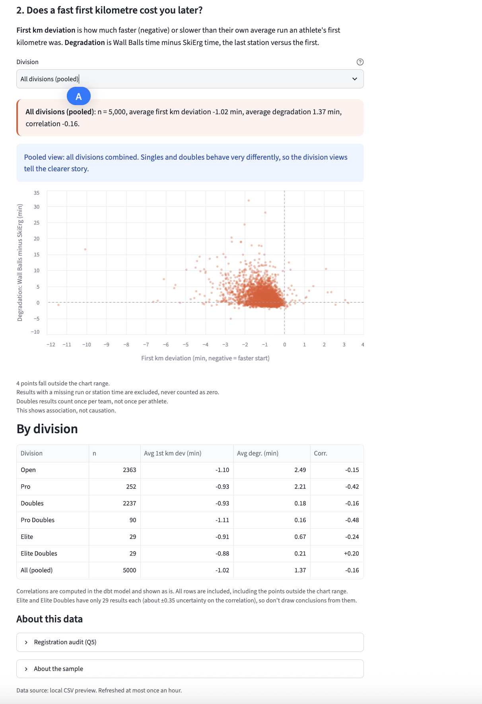
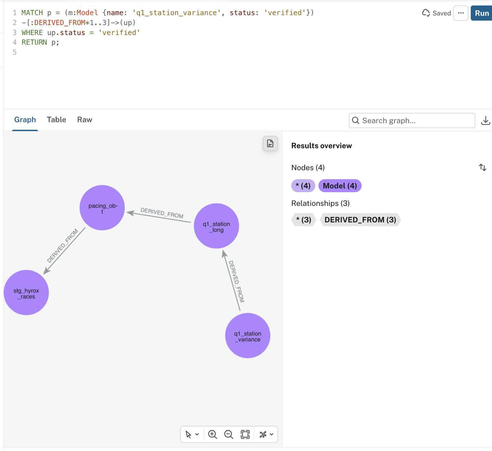
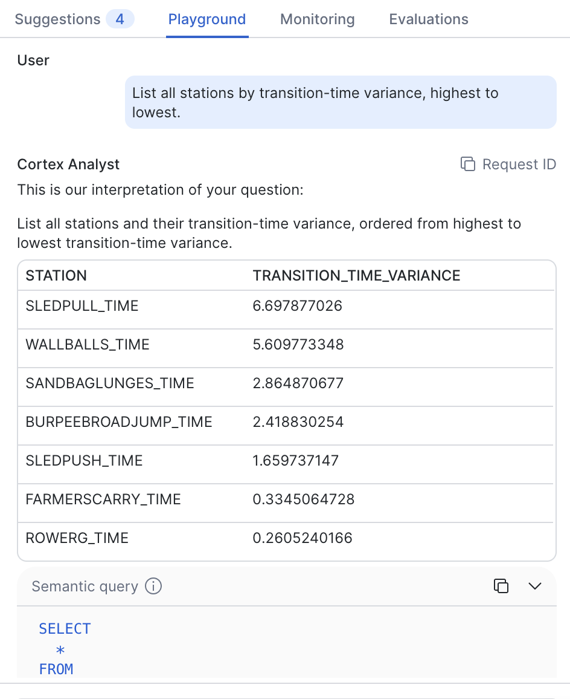
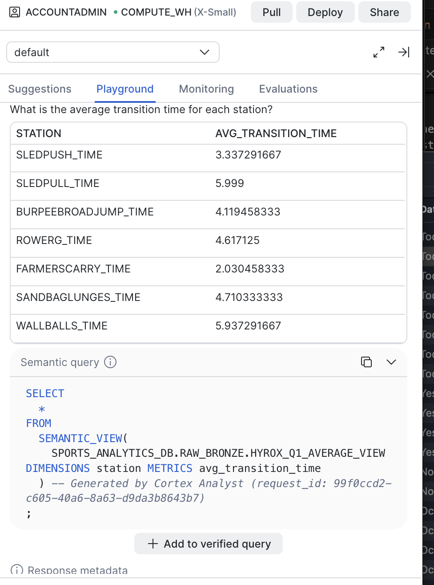
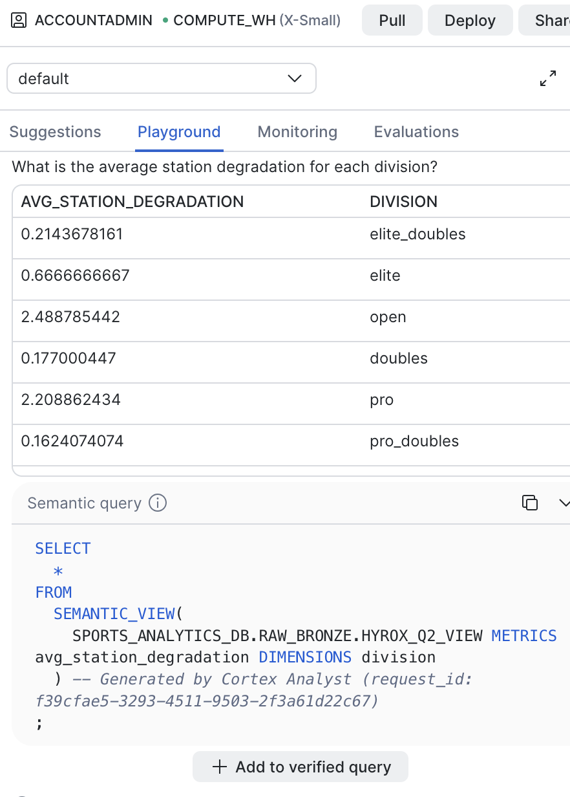
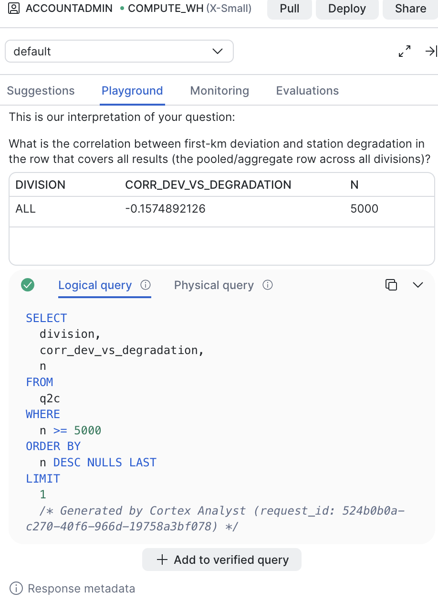

# HYROX Tiered SLA & Performance Analytics Pipeline using Snowflake

For fans of Hyrox workouts, like my niece [Isabele](https://www.linkedin.com/in/isabele-rodman-60bb82293/) who is racing in November 2026 - very inspiring!  

A data engineering pipeline demonstrating a **Tiered SLA architecture** applied to endurance sports analytics using data from Hyrox! 

Built **100% natively inside Snowflake** using Snowpark Python Stored Procedures, Pydantic data validation, Snowpatrol Isolation Forest anomaly detection, dbt and MetricFlow, Apache Ossie semantic models, and Neo4j knowledge graphs. The presentation layer is a mobile-first Streamlit app, served from Render, and reads the same verified tables, and does not re-derive them.

> Live app: https://hyrox-tieredsla-pipeline.onrender.com/ — verified live 2026-11-07. The Snowflake trial behind it ended around 10 Nov 2026, so the Snowflake-backed app lapses with the account; a Databricks-backed version of the same app is built in the hyrox-databricks-port repo, and the 19 Nov 2026 Cortex demo is a frozen recording, not a live session.

##  Recreate this deployment from scratch

> Each step says what to do and where the detail lives. You can see the commands from [RUNBOOK.md](RUNBOOK.md) Or if you just want to rebuild what is running live, follow this list in order. 

- [ ] **Check your Snowflake account first:** In Snowsight, run `SELECT CURRENT_ORGANIZATION_NAME(), CURRENT_ACCOUNT_NAME(), CURRENT_ROLE();` and confirm they match the account and role you're deploying with, and consistent across Snowsight `.env`, and configs in Render.

- [ ] **Clone the repo and set up your credentials.** Copy `.env.example` to `.env` and fill in your Snowflake account, username and password. `.env` is gitignored and never commit it.
- [ ] **Build the Snowflake side.** Follow RUNBOOK.md: fetch the Git repo into Snowflake, run the infrastructure setup, then turn on the Task DAG. Then run a quick select on your raw table (in this repo, `HYROX_RAW_SEASON_8`) to confirm it has rows.
- [ ] **Build the dbt models.** Use dbt Fusion 2.0.8 for the build, and the MetricFlow CLI only for the semantic checks — do not mix them up, or the build will fail with a false error about a missing time spine. Full detail is in RUNBOOK.md.
- [ ] **Check the counts before you call anything done.** The Q1 table must have 8 rows, the Q2 degradation table 5,000, and the Q2 correlation table 7. Hand SQL, the dbt model and the MetricFlow query must all agree.
- [ ] **Create the Cortex semantic views.** After the dbt build, run `sql/cortex_semantic_views.sql` in Snowflake — the four single-table views the Cortex Analyst demo is built on. Do not use the combined view in `sql/cortex_semantic_views_combined_and_test.sql` for the demo; it is superseded by the split views and kept as reference only. The view DDLs and YAML sources live in `sql/cortex/`.
- [ ] **Create the read-only app user.** In Snowflake, create a read-only role and a service user for the app, grant it read access to the three app tables only, and set its RSA public key. Generate the key pair first, fill in the placeholder in `sql/streamlit_access.sql`, then run it; full detail is in `streamlit_app/README.md`.
- [ ] **Deploy the app on Render (optional).** Create a Web Service from this repo, branch `main`, runtime Python 3, instance type Free. Or deploy the Databricks version instead — same `app.py`, Databricks `data.py` (see `streamlit_app/README.md`). Build command: `pip install -r streamlit_app/requirements.txt`. Start command: `streamlit run streamlit_app/app.py --server.port $PORT --server.address 0.0.0.0`. Then add your 7 Snowflake values as environment variables — the variable *names* are fixed by the app code (`SNOWFLAKE_ACCOUNT`, `SNOWFLAKE_USER`, `SNOWFLAKE_PRIVATE_KEY`, `SNOWFLAKE_ROLE`, `SNOWFLAKE_WAREHOUSE`, `SNOWFLAKE_DATABASE`, `SNOWFLAKE_SCHEMA`), plus `PYTHON_VERSION` set to `3.12`.
- [ ] **Check the live page.** Open the Render URL. 
  - "Data source: Snowflake" at the bottom must say, with Sled Pull at 6.70 and the pooled Q2 numbers at n = 5,000, −1.02 / 1.37 / −0.16. 
  - If it says "local CSV preview", it is reading the preview files, not Snowflake. 
  - If it says it could not load the data, check the key pair first — a new private key with an old public key is the usual cause.

> Rebuilding after an expired trial? See [RUNBOOK](RUNBOOK.md) for the full account-level checklist — trial signup, credential handling, verification and Cortex (see `sql/`). 

## Delivery — Streamlit on Render (live)

The app lives in `streamlit_app/`: Q1 bar chart, Q2 scatter with division filter plus by-division correlation table, Q5 data-notes panel, mobile-first layout.

> Live: https://hyrox-tieredsla-pipeline.onrender.com/ — verified 2026-11-07. It reads the Q1 and Q2 tables from Snowflake with a server-side read-only credential (key-pair auth) — in this repo's live deploy those tables are `RAW_BRONZE.Q1_STATION_VARIANCE` and `RAW_BRONZE.Q2_STATION_DEGRADATION` / `Q2_DEVIATION_CORRELATION`, and the credential is the role `HYROX_APP_READER`. Your own deploy will use your own schema and role names. No viewer login. Local preview mode (`HYROX_LOCAL_DATA_DIR`) reads the two preview CSVs instead of Snowflake, so the charts were verified before the live test.
>
> 
>

## Six Sports Analyst Questions (Tiered SLA Framework)

Tier 1: Performance & Pacing Path (Real-Time / Coaching Focus)

    1. Which functional station transition (e.g., moving from Sled Push to Burpee Broad Jumps) exhibits the highest time-loss variance across elite pro division athletes?

    2. How does an athlete's pacing deviation on the first 1km run correlate with performance degradation across the later workout stations?

    3. Which regional event location yields the fastest average transition and run speeds for doubles teams this season?

Tier 2: Official Results & Compliance Path (Audit / Financial Focus)

    4. What are the strictly verified final official podium placements and world ranking points per division after locking in all judge penalties and time adjustments?

    5. Are there any registration anomalies, duplicate IDs, or data discrepancies in the official season-end athlete ledger that impact prize-money distribution?

    6. What is the historical variance in World Championship qualification cutoff times across Seasons 7 and 8?

## Results so far

The sample behind everything below is 5,000 valid rows in
`SPORTS_ANALYTICS_DB.RAW_BRONZE.pacing_obt`, and each question was answered using separate queries. And every result was worked out three ways:
  - hand SQL in Snowsight
  - dbt model
  - MetricFlow query
All three had to agree before I called it a correct result.

### Q1 — Where elite and pro transitions actually vary

This question covers the elite and pro divisions together, 400 results
in total, with one row per result for each of the eight stations. Roxzone
is left out deliberately, because in the elite divisions it's missing
in a way that's perfectly systematic rather than random, and treating
that as data would just invent a story. The variance below is the
sample variance, with 400 observations behind every station:

| Station | Variance | Mean transition time |
|---|---:|---:|
| Sled Pull | 6.70 | 6.00 |
| Wall Balls | 5.61 | 5.94 |
| Sandbag Lunges | 2.86 | 4.71 |
| Burpee Broad Jump | 2.42 | 4.12 |
| Sled Push | 1.66 | 3.34 |
| Farmer's Carry | 0.33 | 2.03 |
| Row Erg | 0.26 | 4.62 |
| Ski Erg | 0.19 | 4.45 |

Sled Pull and Wall Balls are where the
best athletes separate from each other, while SkiErg and RowErg are
remarkably consistent even though their averages are high. Hyrox coaches might consider these insights to focus training on i.e. not on the stations
with the biggest averages, but on the ones where the spread is widest.

### Q2 — Starting fast, and paying for it by Wall Balls

Here the deviation is how much faster or slower an athlete's first
kilometre is than their own average run across the race, and the
degradation is simply their Wall Balls time minus their SkiErg time,
first station to last. One honest note on method: the correlation
itself is computed in hand SQL and in the dbt table, because
correlation isn't something MetricFlow offers as a metric, and I
didn't want to pretend otherwise.

| Division | n | Avg deviation | Avg degradation | Correlation |
|---|---:|---:|---:|---:|
| doubles | 2,237 | −0.93 | 0.18 | −0.16 |
| elite | 29 | −0.91 | 0.67 | −0.24 |
| elite_doubles | 29 | −0.88 | 0.21 | +0.20 |
| open | 2,363 | −1.10 | 2.49 | −0.15 |
| pro | 252 | −0.93 | 2.21 | −0.42 |
| pro_doubles | 90 | −1.11 | 0.16 | −0.48 |
| **Pooled** | **5,000** | **−1.02** | **1.37** | **−0.16** |

Based on the data, Hyrox athletes generally start about
a minute faster than their own pace, and the faster they start relative
to themselves, the more they tend to fade by Wall Balls. 

By Division, singles fade far more on average than doubles do, and pooling them
together just waters that story down. The two elite groups are also
only 29 athletes each, so their correlations carry roughly ±0.35 of
uncertainty. The elite_doubles figures don't feel conclusive. And all of
this is association, not causation: the data says these things move
together, not that one causes the other.

### Q3 and Q4 — blocked as scoped

Q3 asks which location produces the fastest doubles teams this season,
but location and season are only enriched for 58 of the 5,000 rows,
with the rest sitting at location UNKNOWN and season NULL. UNKNOWN
isn't a place, and a missing season isn't "this season," so there's
no honest version of that answer from this sample yet. Q4 is in the
same position for a different reason: the sample simply has no
penalty, points, rank, verification, or podium column, so ranking
points after penalties can't be computed here — and inventing points
to fill the gap would be worse than leaving the question open.

### Q5 — the registration audit

Result IDs are unique across all 5,000 rows, and source result IDs
are unique wherever they exist. The athlete-per-event probe did turn
up two pairs of athletes appearing twice in the same event and
division, which looked like duplicates at first glance, but the
row-level check settled it: each pair was two genuinely different
performances (81.00 versus 115.95 minutes, and 77.88 versus 94.08),
not the same race recorded twice, so neither row was deleted and
nothing in this probe points to a prize-money problem.

### Q6 — blocked as scoped

Q6 asks for the historical variance in World Championship qualification cutoff times across Seasons 7 and 8, but this sample is Season 8 only, so there is no Season 7 baseline to vary against. Like Q3 and Q4, there is no honest version of that answer from this sample yet.

> ### Schema placement
> 
> The gold-tier models live in the gold_marketing folder but materialise into RAW_BRONZE in Snowflake — GOLD_MARKETING is empty — so RAW_BRONZE.pacing_obt is gold, not raw; the true raw table is HYROX_RAW_SEASON_8

> ### Considerations

  - **Grain:** Grain is the fidelity of a data set's cardinality, so count joined rows before any GROUP BY and as a rule don't trust the grouped output alone.
  - **Missing data:** A missing split or run time is never zero, it's not recorded; doubles and relay rows count once, as a team; and a missing season is never defaulted.
  - **Identity:** The `athlete_id` is an attribute key, not a person. It's a hash of name, gender, nationality, and age group, so don't use it alone for person-level analysis, and the full ingest needs a real person key.

## The Business Problem: Two Teams, Two SLAs

- **Marketing / Coaching Team:** Needs hourly latency-optimized pacing metrics and real-time transition splits to power live coaching dashboards.

- **Finance / Official Race Adjudication Team:** Needs reconcilable daily batches with strict anomaly checks and penalty validation before locking in official world rankings and prize payouts.

To accommodate the SLA, the architecture splits ingestion and transformation pipelines, delivering the hourly and a verified auditable from the same source of truth without any external compute.

## Tech Stack & Native Architecture

- **Ingestion:** pre-fetched parquet (`data/hyrox_season_8.parquet` inspected in Colab), validated in batches through a Pydantic generator and bulk-loaded via Snowpark Python (`scripts/raw_ingest.py`). A `pyrox-client` block is commented out in that script. Pyrox is an "unofficial" client for public HYROX results, served from its own CloudFront bucket and is not the Hyrox API nor affiliated with HYROX. A developer using this repo can uncomment that section for a live fetch as desired.

- **Transformation & Modeling:** dbt Core project (`dbt_project/`) compiling incremental silver models and gold OBT/snapshots directly inside Snowflake. Requires creation of Docker images uploaded to Snowflake repo.

- **Storage & Compute:** Snowflake warehousing, serverless task orchestration, and SPCS container pools. 

- **Governance & Quality:** Snowpatrol Isolation Forest anomaly detection acting as a WAP circuit breaker (`scripts/wap_transforms.py`). The current gate is univariate (total_time_minutes); a multivariate extension across per-division and per-station features is the next iteration.

- **Presentation Layer:** Streamlit app in `streamlit_app/`, mobile-first, served from Render with a server-side read-only Snowflake credential (key-pair auth). No viewer login. It reads the Q1 and Q2 tables — it does not recompute them.

- **Semantic & Graph Layer:** dbt semantic models, validated and queried with [MetricFlow](https://docs.getdbt.com/docs/build/build-metrics-intro?version=2) and exported as portable [Apache Ossie](https://github.com/apache/ossie-converters) YAML, and Snowflake-to-Neo4j graph connectors. [Apache Jena](https://jena.apache.org/) for formal ontology or inference is a future roadmap item. Separately, the Snowflake Cortex Analyst demo has its own Snowflake-native semantic views in `sql/cortex_semantic_views.sql` (YAML sources in `sql/cortex/`) — a different layer from the dbt/MetricFlow models, not the same definitions in another format.

- **Operations:** Daily pipeline healthcheck. See [RUNBOOK.md](RUNBOOK.md).

## Lineage and Neo4j knowledge graph

Q1 lineage, verified only: `q1_station_variance → q1_station_long → pacing_obt → stg_hyrox_races`.

### Sample questions the knowledge graph answers

- "What feeds `q1_station_variance`?" — upstream lineage, verified only. Walk DERIVED_FROM edges back to `q1_station_long`, then `pacing_obt`.
- "What breaks if `total_time_minutes` changes?" — downstream impact, verified only. Every model and metric that derives from that column.
- "Which metrics depend on `division`?" — `avg_first_km_deviation` and `avg_station_degradation` via `q2_station_degradation`.

Try omitting `status: 'verified'` filter in any of those queries for the full lineage all the way to bronze, tagged `status: 'unverified'`.

Athlete graph: not yet runnable — parked for now, its UNWIND / MERGE body is still a placeholder.

## Snowflake Cortex Analyst demo — frozen recording, 19 Nov

A separate demo from the Render app: a Cortex Analyst chatbot for my niece Isa, built on four single-table semantic views (`HYROX_Q1_VARIANCE_VIEW`, `HYROX_Q1_AVERAGE_VIEW`, `HYROX_Q2_VIEW`, `HYROX_Q2_CORRELATION_VIEW`). The 19 Nov 2026 demo is a frozen recording, not a live Snowflake session.

The four split views are the demo path and their DDL lives in `sql/cortex_semantic_views.sql`; the YAML sources are in `sql/cortex/`. The combined four-table view (`HYROX_Q1_Q2_SEMANTIC_VIEW`) is superseded by the split views — it is kept as reference in `sql/cortex_semantic_views_combined_and_test.sql`, so verify it against a live GET_DDL before relying on it. Note the two semantic layers in this repo are different things: `dbt_project/models/semantic_models.yml` is the dbt/MetricFlow layer (portable, exported as Ossie), while the `sql/` files are the Snowflake-native Cortex layer — don't mix them up. Cortex Analyst also needs the database role granted: `GRANT DATABASE ROLE SNOWFLAKE.CORTEX_ANALYST_USER TO ROLE ACCOUNTADMIN;`

Recording: [Cortex Analyst demo — frozen recording, 19 Nov](https://github.com/ginobaltazar7/hyrox-tieredsla-pipeline/releases/tag/cortex-demo-2026-11-19) — Release asset `cortex_hyrox_q1_q2_demo720.mov` (47.1 MB), published 2026-11-08, download-and-play, not in-browser streaming. 

Three things to share while building Semantic Views in Snowsight to support Cortex:

1. Semantic-view DDL requires `AS <sql_expr>` for every FACTS, DIMENSIONS and METRICS expression — the bare `alias.column` form fails.
2. Station labels in the Q1 tables carry a `_TIME` suffix (`SLEDPULL_TIME`, `WALLBALLS_TIME`, …) — Cortex needs the exact value, or a filtered question returns no rows.
3. Wording is the translation. For a precomputed fact, the question needs to be phrased as a fetch ("the pooled row"), not a compute ("pooled") — "pooled" invites Cortex to compute the correlation of the per-division averages (−0.29); "the pooled row" fetches the stored ALL row (−0.157, N=5,000).

## Data source and provenance

Data for this repo come from public HYROX race results, fetched with the unofficial `pyrox-client (pyrox.PyroxClient().get_season(season=8))`. Pyrox serves those public results from its own CloudFront bucket and it is not affiliated with, endorsed, or sponsored by HYROX.

This repo uses a 5,000-row sample from the season-8 file, for learning and for demonstrating a semantic layer only. It is not a commercial product, and it is not licensed HYROX data. Please do not use this sample to build a product on scraped results — a shipped product needs athlete-consented data, a licensed API, or manual entry.

The full season-8 file is about 715,000 rows. The 5,000-row sample is deliberate: the ingest script caps the load at 5,000 rows by default, so the sample is what the models and the app were verified against.

Parts of this project, including documentation and analysis, were developed with assistance from Naru, an AI assistant.